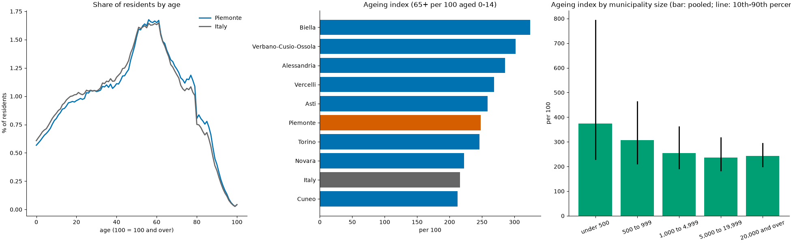

# odp: open data analysis of Piemonte

[](https://github.com/TexAlphaWolf/ana-open-data-piemonte/actions/workflows/ci.yml)
[](https://github.com/TexAlphaWolf/ana-open-data-piemonte/actions/workflows/codeql.yml)


ISTAT's resident population by age and sex on 1 January 2026 for **all 1,180 municipalities of Piemonte**, the 107 provinces and the
20 regions of Italy, read from the files exactly as ISTAT publishes them. From it `odp` computes the **ISTAT demographic indicators**
(ageing index, dependency, turnover, median age, ...) for every unit, compares the eight provinces and Piemonte with the rest of
Italy, and looks at the municipalities by size. Every figure is computed twice, with NumPy and with a deliberately literal
implementation, and the two must agree; the three levels of data must add up to the same population. A command line (`odp`) with
tests, a Docker image and reports generated from the numbers.



## What the numbers say

The data is [ISTAT POSAS 2026](https://demo.istat.it) (population by age, sex and municipality), **an estimate** for 1 January 2026,
not a census count. Speed figures are from one run in Docker on Linux x86_64 with 12 CPUs and Python 3.14.10
([`docs/bench.json`](docs/bench.json); medians of 5 runs). The numbers below are in [`docs/report.json`](docs/report.json).

1. **Piemonte is older than Italy.** Median age 50.8 against 49.3, 27.2% aged 65 and over against 25.1%, 10.9% aged 0 to 14 against
   11.6%. The ageing index is 248.3 against 216.3: for every 100 children there are 248 people aged 65 and over. Among the 20
   regions Piemonte is the 8th oldest by that index; Sardegna (299.7), Liguria (290.2) and Molise (272.4) are the oldest, Trentino-Alto
   Adige (168.5) and Campania (168.8) the youngest.
2. **Within Piemonte the provinces are far apart.** By ageing index Biella (324.1, 3rd oldest of the 107 provinces
   of Italy) and Verbano-Cusio-Ossola (301.5, 7th) are older than every region; Cuneo (212.6, 75th) is younger than Italy as a whole
   (216.3) and Novara (222.1, 66th) is close to it. Torino, with half of the region's residents, is at 246.1.
3. **Small municipalities are older.** The 350 municipalities under 500 residents have an ageing index of 374.4 taken together; the
   32 with 20,000 or more, 242.3. Between municipalities of the same size the spread is wide (for those under 500, the 10th to the
   90th percentile is 229 to 794), so size is a tendency, not a rule.
4. **Population is concentrated.** Torino has 855,654 residents (20.1% of Piemonte), the ten largest municipalities 33.5%; the Gini
   coefficient of municipality sizes is 0.766 and the median municipality has 958 residents. 603 of the 1,180 municipalities have
   fewer than 1,000 residents and together hold 6.6% of the population.
5. **Extremes need a size floor.** Among municipalities with at least 1,000 residents the oldest is Ponzone (1,013 residents, ageing
   index 744.8, median age 61.4) and the youngest Bernezzo (4,276, 119.9, 43.5). Below that size a few families move the index, and
   two municipalities (Ribordone, 43 residents, and Cervatto, 47) have no child at all, so the index does not exist.
6. **The three files agree.** The municipalities of each province add up to the province row, the municipalities of Piemonte to the
   region row (4,255,006), and the 107 provinces to the 20 regions (58,942,828 residents), equal for every age and sex.
7. **Two implementations, one answer.** The NumPy `indicators` and the literal `reference` give identical values on 53 comparisons
   (the three real tables and 50 random ones): 42,991 values compared, the largest relative difference is 0.00e+00.
8. **Speed.** Reading the 8 province files of Piemonte (4.0 MB, 120,360 rows) takes 266.3 ms; the indicators of its 1,180
   municipalities take 3.8 ms against 49.5 ms for the literal version, and the whole report 10.6 ms. The NumPy version is 8 to 13
   times faster than the literal one (100,000 units: 440.1 ms against 4.00 s).

[`docs/analysis.md`](docs/analysis.md) goes through the results; [`docs/method.md`](docs/method.md) defines the data format, the checks
and every indicator; [`docs/architecture.md`](docs/architecture.md) shows how the pieces fit; [`docs/report.md`](docs/report.md) and
[`docs/bench.md`](docs/bench.md) are the generated reports.

## Quick start

With Docker (nothing else to install):

```bash
docker build -t odp .
RUN="docker run --rm --read-only --tmpfs /tmp --cap-drop ALL --security-opt no-new-privileges --network none odp"
$RUN check-data                  # read the files, check that the three levels add up and the hashes
$RUN report                      # the summary
$RUN comune Biella               # the indicators of one municipality
$RUN indicators --top 5          # the oldest municipalities with at least 1,000 residents
```

With Python 3.11 to 3.14:

```bash
pip install .
odp check-data
odp report --out out             # report.json, report.md and summary.png in out/
odp indicators --level provincia --top 3
odp verify
```

## Real output

`odp report`:

```text
Piemonte, ISTAT 1 January 2026, estimate: 1,180 municipalities, 4,255,006 residents
median age 50.8 (Italy 49.3), aged 65+ 27.2% (Italy 25.1%), ageing index 248.3 (Italy 216.3), rank 8 of 20 regions
oldest province by ageing index: Biella, youngest: Cuneo
the municipalities, provinces and regions add up to the same population
```

`odp comune Ponzone` (the oldest municipality with at least 1,000 residents):

```text
Ponzone (006136), province Alessandria
  population               1,013.0   residents on 1 January
  share_0_14                   5.7   % aged 0 to 14
  share_15_64                 51.6   % aged 15 to 64
  share_65_plus               42.6   % aged 65 and over
  share_85_plus                8.6   % aged 85 and over
  ageing_index               744.8   aged 65+ per 100 aged 0-14 (indice di vecchiaia)
  dependency                  93.7   (0-14 plus 65+) per 100 aged 15-64 (indice di dipendenza strutturale)
  old_age_dependency          82.6   65+ per 100 aged 15-64 (indice di dipendenza degli anziani)
  turnover                   461.9   aged 60-64 per 100 aged 15-19 (indice di ricambio della popolazione attiva)
  working_age_structure      241.8   aged 40-64 per 100 aged 15-39 (indice di struttura della popolazione attiva)
  sex_ratio                  108.0   males per 100 females
  median_age                  61.4   median age, interpolated inside the single year of age
  mean_age                    57.8   mean age, each class counted at its middle
  residents by ten-year class: 0-9: 34, 10-19: 45, 20-29: 61, 30-39: 71, 40-49: 88, 50-59: 185, 60-69: 201, 70-79: 183, 80-89: 109, 90-99: 33, 100+: 3
```

`odp verify --draws 5`:

```text
ok   municipalities of Piemonte: 1180 units, 15,340 values, largest relative difference 0.0e+00
ok   provinces of Italy: 107 units, 1,391 values, largest relative difference 0.0e+00
ok   regions of Italy: 20 units, 260 values, largest relative difference 0.0e+00
ok   random table 1: 40 units, 520 values, largest relative difference 0.0e+00
ok   random table 2: 40 units, 520 values, largest relative difference 0.0e+00
ok   random table 3: 40 units, 520 values, largest relative difference 0.0e+00
ok   random table 4: 40 units, 520 values, largest relative difference 0.0e+00
ok   random table 5: 40 units, 520 values, largest relative difference 0.0e+00
8 of 8 comparisons agree with the literal implementation
```

## The data

[`data/istat/`](data/istat) holds ten files exactly as ISTAT publishes them (the layout is described in
[`docs/method.md`](docs/method.md)): `POSAS_2026_it_<code>_<province>.csv` for each of the eight provinces of Piemonte (001 Torino,
002 Vercelli, 003 Novara, 004 Cuneo, 005 Asti, 006 Alessandria, 096 Biella, 103 Verbano-Cusio-Ossola), `POSAS_2026_it_Province.csv`
(107 provinces) and `POSAS_2026_it_Regioni.csv` (20 regions). [`data/SHA256SUMS`](data/SHA256SUMS) lists their hashes and
`odp check-data` verifies them. The file with all 7,896 Italian municipalities (27 MB) is not included; `odp bench --national FILE`
can time reading it.

Source: ISTAT, *Popolazione residente per età, sesso e stato civile* (POSAS), 2026, https://demo.istat.it, used under ISTAT's open
data terms (CC BY 4.0 attribution). The code is MIT licensed; the data keeps its own terms.

## Commands

| Command | What it does |
|---|---|
| `odp check-data [--data DIR] [--manifest FILE]` | Reads the files, checks that municipalities, provinces and regions add up, and the hashes; exit code 1 on a hash mismatch |
| `odp report [--out DIR]` | The analysis; with `--out` writes `report.json`, `report.md` and `summary.png` |
| `odp indicators [--level comune\|provincia\|regione] [--sort NAME] [--ascending] [--top N] [--min-population N]` | The indicators of the units of a level, sorted (municipalities: at least 1,000 residents by default) |
| `odp comune NAME_OR_CODE` | All indicators of one municipality of Piemonte |
| `odp verify [--draws N] [--seed S] [--random-only]` | Compares the NumPy indicators with the literal ones; exit code 1 on a difference |
| `odp bench [--sizes ...] [--ref-max N] [--repeat R] [--draws N] [--seed S] [--national FILE] [--out DIR]` | Speed of reading and of the indicators, and the agreement |
| `odp render FILE.json [-o FILE.md] [--figure FILE.png]` | Rebuilds the Markdown (and figure) from a `report.json` or `bench.json` |

Exit codes: 0 success, 1 a hash mismatch or a verification failure, 2 an error (a missing or malformed file, an unknown municipality).

## How it is checked

- The reader is strict: exact header, code widths, integers, males plus females equal the total, every age from 0 to 100 once and
  the all-ages row equal to their sum. A file that is not as ISTAT publishes it is refused with the line that is wrong.
- [`reference.py`](src/odpiemonte/reference.py) computes the indicators with plain loops over the 101 ages;
  [`indicators.py`](src/odpiemonte/indicators.py) does it with NumPy for all units at once. `odp verify` compares them on the real
  tables and on random awkward ones (empty classes, no children, no one over 60, one resident).
- The three levels of data reconcile by age and sex, which would show a wrong or truncated file.

## Development

```bash
pip install -e ".[dev]"
ruff check . && ruff format --check . && mypy && pytest --cov
```

CI runs this on Python 3.11 to 3.14, again with more random draws and another seed, on Windows and macOS, builds the Docker image
and runs the end-to-end scripts (`tools/docker_e2e.sh`, and `tools/docker_e2e.ps1` from PowerShell). `tools/run_full.ps1`
produces the measurements in this README.

## Limits

These are estimates, not a census, and only for 1 January 2026: there is no time series, so nothing here says how Piemonte is
changing. The data has no geometry, hence no maps; and no citizenship, birth place or marital status. Indicators of small
municipalities are noisy, which is why the rankings ask for 1,000 residents. See [`docs/limitations.md`](docs/limitations.md).

MIT license.
